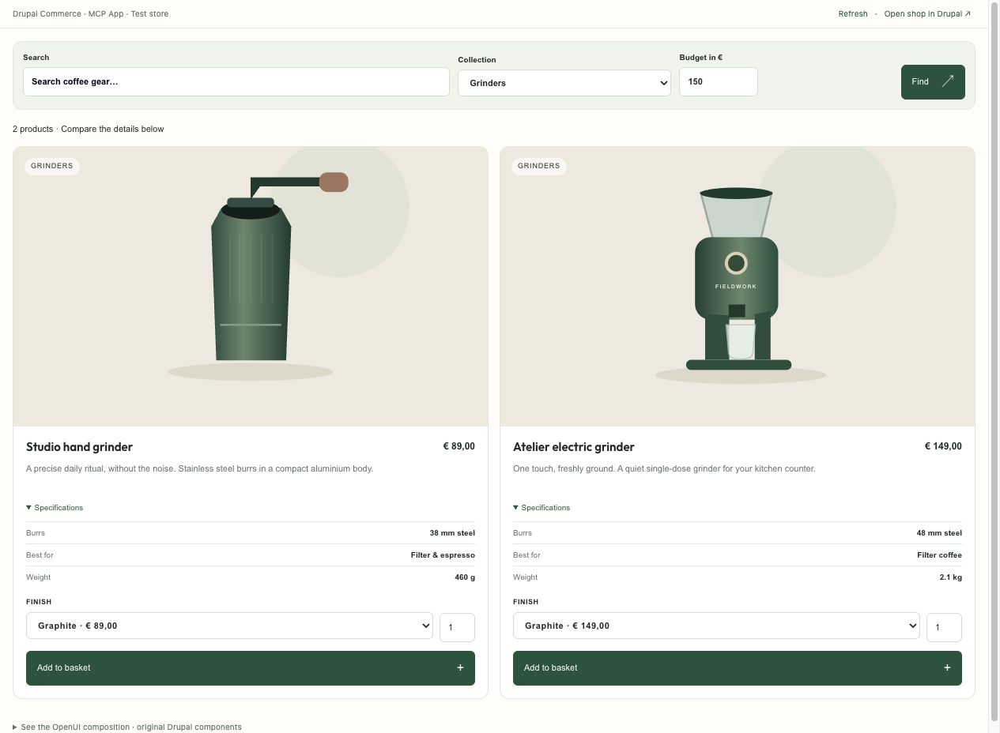
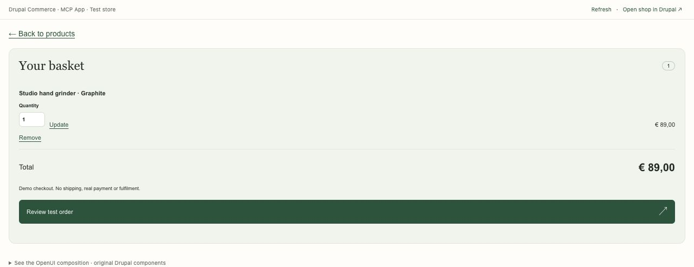
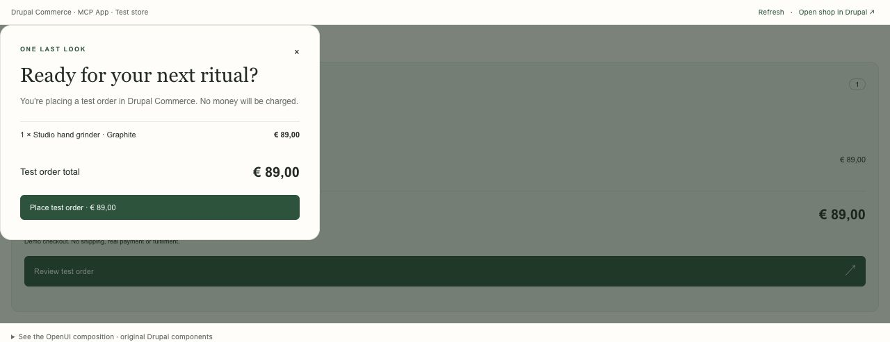
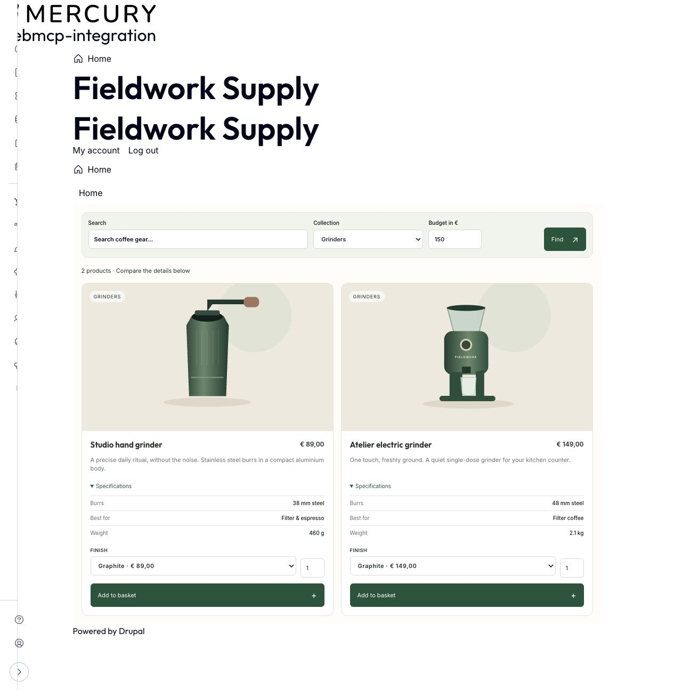

In my previous post about [MCP Apps in Drupal](/blog/mcp-apps-drupal-tool-api/), I explored how Drupal tools can be reused across different interfaces.

[Tool API](https://www.drupal.org/project/tool) lets Drupal define an operation once. A normal Drupal interface can use it, a workflow can use it, and an external agent can reach it through [MCP Server](https://www.drupal.org/project/mcp_server).

[MCP Apps](https://modelcontextprotocol.io/extensions/apps/overview) add an interface for cases where text is not enough. A tool declares an interactive application that a supporting MCP host can render alongside the conversation.

In that first demo, Drupal provided the tools for finding an article, searching Media and saving a new hero image. The app added the visual step I needed to compare the images and make a choice.

While working on that, another question started nagging me: if the tools can be reused, what about the components?

## If tools can be reused, what about components?

That question also took me back to [DrupalCon Rotterdam](https://www.drupal.org/blog/driesnote-rotterdam).

The [Canvas demos](https://www.drupal.org/blog/proof-not-promises-watch-the-six-demos-from-the-driesnote-rotterdam) showed components becoming a larger part of how Drupal sites are built. Code Components give JavaScript developers another way to build them, while Canvas Headless connects Drupal's editing experience to applications outside the normal Drupal frontend.

Drupal already has [Single Directory Components](https://www.drupal.org/docs/develop/theming-drupal/using-single-directory-components). An SDC keeps its prop schema, Twig template and attached CSS and JavaScript together.

I hadn't worked much with these parts of Drupal before, and my front-end skills are not the best, but I wanted to try something fairly specific. If a component already exists in Drupal, could an MCP App use it too?

I wanted Drupal to render the original component and let the app show that result. Maintaining another copy of its template and styling would take away much of the reason for doing this.

## Let Drupal render the component

An SDC describes what a component accepts. It can define props such as a title, image, price or list of data, and named slots that contain other components.

That gives us something to expose to an agent: the component ID, its supported props and the slots it can fill. Drupal still has the schema and rendering code needed to check the composition and produce the interface.

The adapter discovers components through Drupal's component manager, builds normal `#type: component` render arrays and renders their original Twig templates. It also collects the assets attached to that output.

There is no React version of the product card, basket or other Drupal components in this demo.

## Where OpenUI fits

For this proof of concept, I am using [OpenUI](https://www.openui.com/docs/openui-lang/renderer).

OpenUI lets an application define a component library and parse compositions that refer to those components. My integration gives it a `DrupalComponent` wrapper around supported SDCs discovered by Drupal.

A small composition could look like this:

```text
root = Page([
  DrupalComponent(
    "mcp_apps_commerce_demo:basket_summary",
    {"count": 1, "total": "€89.00"},
    {}
  )
])
```

This illustrates the composition format. In the shopping flow, Drupal supplies the count and formatted total from Commerce. The app does not calculate an authoritative price from a model-generated string.

`Page` is the container used by the OpenUI integration. It does not create a Drupal or Canvas page. The third argument to `DrupalComponent` holds named slots, which can contain more components.

OpenUI's parser and React renderer handle the composition wrapper. Drupal validates the resulting tree and renders the actual components. React handles the app shell and host connection.

The general SDC integration can accept an OpenUI program created by the agent. For the Commerce demo, I use a more controlled flow: the agent chooses filters and a mode, and Drupal builds the composition from the tool results. I still do not think every interface needs the model to assemble it.

## A shop makes the example easier to follow

The demo is a small coffee-gear shop called Fieldwork Supply, built with [Drupal Commerce](https://www.drupal.org/project/commerce).

The products and branding are fictional, but they are real Commerce product and variation entities. Prices are resolved by Commerce. Adding a product updates a Commerce cart, and test checkout can create a completed order with a simulated payment.

In Codex, I can ask:

> Help me choose a coffee grinder under €150. Show the shopping app.

That opens two matching grinders: a €89 hand grinder and a €149 electric grinder. Their specifications are visible immediately. Asking for help choosing should give me something to compare without first making me select two Compare checkboxes.



*The shipped app interface in its browser development preview. Drupal renders both product cards and their specifications. This preview uses a local Drupal transport; the actual MCP App is opened through the host's MCP connection.*

The agent can request `mode: choose` to show the specifications immediately, or `mode: browse` for a normal catalog with manual comparison. The default `auto` mode expands the details when there are two or three matching products.

That is a useful distinction for me. The tools and components stay the same, while the initial interface follows what I asked for.

## What calls what?

The shopping demo adds four Tool API adapters around Commerce:

- `commerce_demo_catalog` returns accessible products, variations, resolved prices and specifications.
- `commerce_demo_cart` returns the authenticated customer's basket.
- `commerce_demo_cart_update` changes an item's quantity through Commerce's Cart Manager.
- `commerce_demo_checkout` places a reviewed test order through the dedicated simulated gateway.

These operations can be used independently of the app. I wrote the adapters and the mapping into component props; Commerce supplies the pricing, availability, cart and payment services underneath them.

The app opens through `commerce_shop_open`, exposed by the bridge as `tool_api__commerce_shop_open`:

```text
Agent calls commerce_shop_open with filters and a mode
    ↓
Drupal invokes the Commerce adapters through Tool API
    ↓
Drupal maps the results into SDC props and slots
    ↓
The app describes and parses that composition with OpenUI
    ↓
The app requests a native preview through the MCP host
    ↓
Drupal validates and renders the original SDCs and assets
    ↓
The app displays the result
```

The tool declares `_meta.ui.resourceUri` pointing to `ui://drupal/commerce-shop`. MCP Server serves the HTML resource with MIME type `text/html;profile=mcp-app`, and the host loads it into its sandbox.

HTML and asset bytes travel as app presentation metadata. The model receives the smaller structured results, such as the number of matches and basket total.

## From choosing a product to reviewing a basket

The demo uses six module-owned SDCs: `shop`, `product`, `comparison`, `basket_summary`, `basket` and `receipt`.

I can choose a finish, add a product and continue from a compact basket summary. The summary contains an item count, total and Proceed button. The full basket is a separate step, so it does not compete with the product comparison for the limited space inside a chat.

The basket component contains the quantity controls and order total. Back to products keeps the filters and comparison context. Review test order opens the confirmation interface before the final action.



*The live Commerce basket in the app's browser development preview. I temporarily added one €89 grinder for these screenshots and removed it afterward.*



*The basket's review dialog, before the final action. No order was placed and no payment was made for these screenshots.*

These are ordinary Drupal components. Their attached JavaScript handles the controls on the website and in the app. The app connects those actions to an allowlisted set of host-mediated tool calls.

## Interactions without another model call

The model gets the flow started. It does not need to decide what to do each time I change a finish, adjust a budget or update a quantity.

Changing a filter calls an app-only tool through the MCP host. Drupal invokes the catalog operation through Tool API, rebuilds the composition and renders the updated components. Basket updates go through the reusable cart operation in the same way.

Choosing a finish updates the displayed price locally. Adding that variation still goes back to Drupal, where Commerce resolves the price and checks availability. The browser's displayed value is not the authority for saving the cart.

The basket and product views share the same session state. Moving between them does not require another conversation with the model.

## The same components on the website

The shop is also available as a normal Drupal page at `/shop`.



*The same product SDCs on the Drupal website, with Grinders, a €150 budget and choice mode selected. The surrounding page layout belongs to the site's theme.*

Both surfaces use the same Tool API operations, component mapping, Twig templates and attached component assets. The app receives a Drupal-rendered preview; the website puts the render array into a normal page.

Their surrounding layouts are different. The website has the site's navigation and page wrapper, while the app has its host and compact controls. The demo components inherit the active theme's fonts and base styling, with their own CSS for the shop layout and palette.

The basket is shared when both connections use the same Drupal account. It is not copied into a separate app store.

## Where the different protocols fit

I had to untangle how [MCP Apps](https://modelcontextprotocol.io/extensions/apps/overview), [AG-UI](https://docs.ag-ui.com/introduction), OpenUI and [A2UI](https://a2ui.org/) relate.

MCP Apps lets the Drupal server provide an application that a supporting host can render inside the conversation. The host owns the surrounding chat, sandbox and connection. Support still differs between clients.

AG-UI defines events exchanged between an agent backend and a user-facing application. It is useful when building that conversation frontend. Here, Codex already supplies it.

OpenUI and A2UI describe interfaces using known components. OpenUI provides the composition language and parser used in this adapter. A2UI uses declarative messages that a client maps to its component library. This implementation uses OpenUI.

## Access and checkout still belong to Drupal

The app calls tools using the OAuth identity behind the MCP connection. Drupal checks the user's permissions, entity and field access, and Commerce availability. Test checkout requires an additional permission, and cart operations enforce ownership even for administrators.

Opening the website is a separate browser login. The app's OAuth token does not sign that browser into Drupal. The current demo requires an authenticated website user with the appropriate permissions, so that handoff still needs a friendlier login experience.

Checkout is deliberately limited. The dedicated gateway only supports test mode and reuses Commerce's manual payment implementation. It records a simulated payment and places a Commerce order; no real money is charged, receipt email sent or delivery initiated.

Before placing the order, Drupal refreshes the prices and checks the reviewed basket revision. A changed total requires another review. Tests also cover access denial, account isolation, rollback after a payment has been saved, and repeated checkout returning the same completed order.

Production checkout would need the storefront's configured payment gateways, address collection, shipping and checkout behaviour. Those are outside this demo.

## Current boundaries

I am still treating this as a proof of concept.

The SDC adapter supports JSON-compatible props and supported local attached assets. It reports schemas and references it cannot represent, and rejects external assets and private files. Component JavaScript can run inside the preview's sandbox.

OpenUI state, Query and Mutation expressions are not supported by this first adapter. The shopping controls use explicit JavaScript handlers and an allowlisted tool map.

I mapped the Commerce tool results into a known set of components myself. Automatic binding between an arbitrary Tool API result and an arbitrary SDC is not part of this yet. The Commerce demo also does not create or edit Canvas pages.

## Contributing back

This experiment lives in the [Drupal MCP Apps repository](https://github.com/ronaldtebrake/drupal_mcp_apps) and builds on [Agent Access](https://www.drupal.org/project/agent_access) for the OAuth and MCP connection.

The reusable OpenUI integration is separate from the optional Commerce demo. I want other modules to be able to provide their own tools and components without depending on a coffee shop.

The demo uses pinned patches for three contributions:

- [MCP Server MR !89](https://git.drupalcode.org/project/mcp_server/-/merge_requests/89): SDK MCP Apps extension registration and preservation of native tool and resource metadata.
- [Tool API MR !206](https://git.drupalcode.org/project/tool/-/merge_requests/206): generic metadata on tool definitions and execution results.
- [MCP Server Tool Bridge MR !28](https://git.drupalcode.org/project/mcp_server_tool_bridge/-/merge_requests/28): forwarding the MCP metadata namespace into MCP definitions and results.

Native Drupal plugins still register the tools and resources. The module consumes the server and SDK APIs rather than replacing the server factory.

I used OpenAI Codex while building this, including help with the module code, tests, documentation, contribution patches and this post. The fictional product illustrations were also created with Codex assistance and are included with the module under GPL-2.0-or-later. OpenUI is MIT licensed, and the repository retains its bundled dependency notices.

## Where this leaves me

The shopping demo gives me the answer I was looking for, at least for this example. The operations go through Tool API, Commerce handles the underlying data and Drupal renders the SDCs. I can use those operations and components on the website and inside the app.

There is still more to work out. The mapping between tool results and components is explicit, and the browser login handoff is unfinished. I do not know yet what the right Drupal approach for more automatic composition should be.

That brings me back to the [Rosetta Sprint](https://www.drupal.org/blog/driesnote-rotterdam). Its goal is to describe Drupal's capabilities once, in a form that agents, other systems and people can use. Components are not necessarily part of that same description, but this experiment helped me see how the two could meet.

The [data surfaces proposal](https://www.drupal.org/project/drupal/issues/3622144) explores a related problem: giving forms and other consumers a shared definition of accepted values, instead of keeping those rules inside each interface.

For this demo, I can already describe the operation through Tool API and the component through its SDC schema. I am looking forward to the Rosetta Sprint as a chance to compare experiments like this and work out which parts Drupal can describe and reuse more consistently.

## References

- [Drupal MCP Apps proof of concept](https://github.com/ronaldtebrake/drupal_mcp_apps)
- [MCP Apps OpenUI integration](https://github.com/ronaldtebrake/drupal_mcp_apps/blob/main/modules/mcp_apps_openui/README.md)
- [MCP Apps overview](https://modelcontextprotocol.io/extensions/apps/overview)
- [OpenUI renderer](https://www.openui.com/docs/openui-lang/renderer)
- [AG-UI](https://docs.ag-ui.com/introduction)
- [A2UI](https://a2ui.org/)
- [Single Directory Components](https://www.drupal.org/docs/develop/theming-drupal/using-single-directory-components)
- [Drupal Commerce](https://www.drupal.org/project/commerce)
- [Tool API](https://www.drupal.org/project/tool)
- [MCP Server](https://www.drupal.org/project/mcp_server)
- [Data surfaces](https://www.drupal.org/project/drupal/issues/3622144)
- [DriesNote Rotterdam](https://www.drupal.org/blog/driesnote-rotterdam)
- [The six DriesNote demos](https://www.drupal.org/blog/proof-not-promises-watch-the-six-demos-from-the-driesnote-rotterdam)
- [Agent Access](https://www.drupal.org/project/agent_access)
